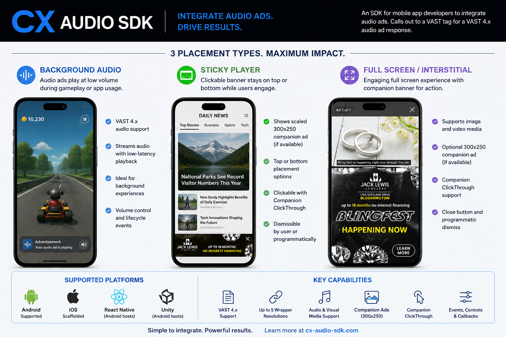

# cx-audio-sdk
An SDK for mobile app developers to integrate audio ads.  Calls out to a VAST tag for a VAST 4.x audio ad response.

## Documentation

- [Quick start](docs/QUICK_START.md): install the SDK and play a first
  background audio ad on Android, iOS, React Native, or Unity.
- [Advanced usage](docs/ADVANCED_USAGE.md): placements, request metadata,
  options, lifecycle, privacy, timeouts, raw QA tags, and troubleshooting.
- [Privacy and Consent Architecture](docs/PRIVACY_ARCHITECTURE.md): mandatory
  privacy ownership and enforcement design.
- Platform detail: [iOS](ios/README.md), [Unity](unity/README.md), and the
  [Flappy Blob sample](samples/flappy-ios/README.md).

## Quick Start

The shortest complete integrations are in the
[cross-platform quick start](docs/QUICK_START.md). Replace
`YOUR_PLACEMENT_HASH` with the placement hash supplied by CX. The primary flow
does not require a raw VAST URL or advertising identifier.

> [!IMPORTANT]
> The automatic privacy ingestion and centralized enforcement described in [Privacy and Consent Architecture](docs/PRIVACY_ARCHITECTURE.md) are accepted target architecture but are not fully implemented in the current SDK. Before a production release, review the [Advertising Identifiers](#advertising-identifiers) section and applicable platform privacy requirements. The host app owns consent collection and user-facing privacy prompts.

### Integration Lifecycle

| State | Developer action | SDK behavior |
| --- | --- | --- |
| Host ready | Complete app-owned consent UI and configure the app audio session when applicable. | No SDK request has started. |
| Configured | Create a `ConsumableAdRequest` with the placement hash and normal app metadata. | Builds the placement request from structured values. |
| Loading | Call the placement's `play(...)` or `show(...)` method and retain its handle. | Loads VAST and the required creative asynchronously. |
| Active | Respond to started, loaded, clicked, or completed callbacks as needed. | Plays the creative and fires supported tracking events. |
| Terminal | On completion, failure, stop, or dismissal, clear the retained handle. Call `stop()` or `dismiss()` when the host flow ends early. | Stops work and releases placement resources. |

The host app owns consent collection and user-facing privacy prompts. Do not add a second consent dialog for the SDK. See [Privacy and Consent Architecture](docs/PRIVACY_ARCHITECTURE.md) for the accepted ownership and enforcement model.

### Placement Request Routing

For requests built with `ConsumableAdRequest`, choose the SDK placement type and let the SDK construct the Consumable VAST URL. The SDK adds its internal placement signal automatically:

| Public placement | Internal request code | Expected demand |
| --- | ---: | --- |
| Background audio | `1` | Audio |
| Sticky audio | `2` | Audio with the sticky placement's visual support |
| Fullscreen interstitial | `3` | Video-compatible interstitial response |

The internal query parameter is not publisher configuration and should not be added or overridden by host apps. Raw VAST URLs supplied for QA or non-Consumable ad servers are passed through unchanged.

### Android

```java
import android.app.Activity;

import com.cx.audio.android.AndroidBackgroundAudio;
import com.cx.audio.android.BackgroundAudioHandle;
import com.cx.audio.android.BackgroundAudioListener;
import com.cx.audio.android.BackgroundAudioOptions;
import com.cx.audio.android.BackgroundAudioRequest;
import com.cx.audio.android.ConsumableAdRequest;

public final class MainActivity extends Activity {
    private BackgroundAudioHandle backgroundAd;

    private void playAudioAd() {
        ConsumableAdRequest adRequest = ConsumableAdRequest
                .builder("YOUR_PLACEMENT_HASH")
                .appName("Example App")
                .appBundle(getPackageName())
                .build();

        BackgroundAudioRequest request = BackgroundAudioRequest
                .builder(this, adRequest)
                .build();

        backgroundAd = AndroidBackgroundAudio.play(
                this,
                request,
                BackgroundAudioOptions.builder().build(),
                new BackgroundAudioListener() {
                    @Override
                    public void onBackgroundAudioStarted(BackgroundAudioHandle handle) {
                        // The ad is playing.
                    }

                    @Override
                    public void onBackgroundAudioCompleted() {
                        backgroundAd = null;
                    }

                    @Override
                    public void onBackgroundAudioStopped() {
                        backgroundAd = null;
                    }

                    @Override
                    public void onBackgroundAudioFailed(Throwable error) {
                        backgroundAd = null;
                    }
                });
    }

    @Override
    protected void onDestroy() {
        if (backgroundAd != null) {
            backgroundAd.stop();
            backgroundAd = null;
        }
        super.onDestroy();
    }
}
```

### iOS

```swift
import Foundation
import CxAudioSDK

final class AudioAdController: BackgroundAudioListener {
    private var backgroundAd: BackgroundAudioHandle?

    func playAudioAd() throws {
        let adRequest = try ConsumableAdRequest(
            placementHash: "YOUR_PLACEMENT_HASH",
            appName: "Example App",
            appBundle: Bundle.main.bundleIdentifier
        )

        let request = try VastRequest(
            consumableAdRequest: adRequest,
            placement: .backgroundAudio
        )

        backgroundAd = CxBackgroundAudio.play(
            request: request,
            listener: self
        )
    }

    func stopAudioAd() {
        backgroundAd?.stop()
        backgroundAd = nil
    }

    func backgroundAudioDidStart(_ handle: BackgroundAudioHandle) {
        // The ad is playing.
    }

    func backgroundAudioDidComplete() {
        backgroundAd = nil
    }

    func backgroundAudioDidStop() {
        backgroundAd = nil
    }

    func backgroundAudioDidFail(_ error: Error) {
        backgroundAd = nil
    }
}
```

### React Native

React Native currently supports Android host apps. Retain the returned handle ID and remove the event subscription when the owning component unmounts.

```js
import {
  addCxAudioListener,
  BackgroundAudio,
  createConsumableVastRequest,
} from 'cx-audio-sdk';

let backgroundAdHandle = null;

const subscription = addCxAudioListener((event) => {
  const isTerminal = ['completed', 'stopped', 'failed'].includes(event.type);
  const isCurrentAd = event.handleId === backgroundAdHandle;
  if (event.placement === 'backgroundAudio' && isTerminal && isCurrentAd) {
    backgroundAdHandle = null;
  }
});

export async function playAudioAd() {
  const request = createConsumableVastRequest({
    placementHash: 'YOUR_PLACEMENT_HASH',
    placement: 'backgroundAudio',
    appName: 'Example App',
    appBundle: 'com.example.app',
  });

  backgroundAdHandle = await BackgroundAudio.play(request);
}

export async function stopAudioAd() {
  if (backgroundAdHandle) {
    const handle = backgroundAdHandle;
    backgroundAdHandle = null;
    await BackgroundAudio.stop(handle);
  }
}

export function disposeAudioAds() {
  subscription.remove();
  void stopAudioAd().catch(() => {});
}
```

### Unity

Unity currently supports Android player builds. Retain and dispose the native handle when playback reaches a terminal state or the owning `MonoBehaviour` is destroyed.

```csharp
using Cx.Audio.Unity;
using UnityEngine;

public sealed class AudioAds : MonoBehaviour, IBackgroundAudioListener
{
    private BackgroundAudioHandle backgroundAd;

    public void PlayAudioAd()
    {
        ConsumableAdRequest adRequest =
            new ConsumableAdRequest("YOUR_PLACEMENT_HASH")
                .AppName("Example App")
                .AppBundle(Application.identifier);

        VastRequest request = new VastRequest(
            adRequest,
            ConsumablePlacement.BackgroundAudio);

        backgroundAd = BackgroundAudio.Play(
            request,
            new BackgroundAudioOptions(),
            this);
    }

    public void StopAudioAd()
    {
        if (backgroundAd == null)
        {
            return;
        }

        backgroundAd.Stop();
        ReleaseHandle();
    }

    private void OnDestroy()
    {
        StopAudioAd();
    }

    public void OnBackgroundAudioStarted(BackgroundAudioHandle handle)
    {
        // The ad is playing.
    }

    public void OnBackgroundAudioCompleted()
    {
        ReleaseHandle();
    }

    public void OnBackgroundAudioStopped()
    {
        ReleaseHandle();
    }

    public void OnBackgroundAudioFailed(CxAudioError error)
    {
        ReleaseHandle();
    }

    private void ReleaseHandle()
    {
        if (backgroundAd != null)
        {
            backgroundAd.Dispose();
            backgroundAd = null;
        }
    }
}
```

For additional placements and options, continue with
[Advanced usage](docs/ADVANCED_USAGE.md), [Android background
audio](#android-background-audio), the complete [iOS guide](ios/README.md),
[React Native](#react-native), or [Unity](#unity).

## Target Platforms
- Android
- iOS
- React Native
- Unity

## Placement Types
| Placement | Description |
| --- | --- |
| Background audio | Plays at low volume during gameplay or app usage. |
| Sticky player | Clickable small horizontal banner at the top or bottom of the screen showing a scaled-down version of the 300x250 companion banner ad, if present. |
| Full screen / interstitial | Static slate image or video on the top, with a clickable 300x250 companion banner ad on the bottom, if present. |



## Implementation Matrix
| Placement | Android | iOS | React Native | Unity |
| --- | --- | --- | --- | --- |
| Background audio | Supported | Supported | Supported on Android hosts | Supported on Android hosts |
| Sticky player | Supported | Supported | Supported on Android hosts | Supported on Android hosts |
| Full screen / interstitial | Supported | Supported | Supported on Android hosts | Supported on Android hosts |

## Sample Apps
Native sample apps live under `samples/`. The Android and general iOS QA samples expose controls for testing all three placement types. Flappy Blob demonstrates placements triggered by host-app gameplay state.

### Android Sample
Android sample module: `:sample-android`

Build the sample APK:

```sh
./gradlew :sample-android:assembleDebug
```

Open `samples/android` in Android Studio or install the debug APK on an emulator/device. The sample app lets you test:

- Background audio playback and stop.
- Sticky player render, click, and dismiss.
- Full screen interstitial render, click, video/image playback, and dismiss.

### iOS Sample
iOS sample project: `samples/ios/CxAudioSample.xcodeproj`

Open the project in Xcode, choose an iOS simulator or device, and run the `CxAudioSample` app target. The project links the local `CxAudioSDK` Swift package from the repository root.

The sample app lets you test:

- Background audio playback and stop.
- Sticky player render, click, and dismiss.
- Full screen interstitial render, click, video/image playback, and dismiss.

### iOS Flappy Sample
iOS game sample workspace: `samples/flappy-ios/CxFlappyBird.xcworkspace`

See the [Flappy Blob sample integration guide](samples/flappy-ios/README.md) for direct links to its placement requests, SDK calls, listeners, lifecycle cleanup, and state policy.

Build the sample app:

```sh
xcodebuild -workspace samples/flappy-ios/CxFlappyBird.xcworkspace -scheme CxFlappyBird -destination 'generic/platform=iOS Simulator' build CODE_SIGNING_ALLOWED=NO
```

The sample is a small aquatic Flappy Blob game demonstrating state-driven integration. It can show one sticky placement while the game is idle on the ready screen, dismisses that placement when play starts, and shows frequency-capped fullscreen interstitials at eligible game-over transitions. It does not request new ads during an active run.

## Android Build
Android module: `:android`

Minimum SDK: 23

Runtime dependencies: none beyond the Android platform.

Prerequisites:

- JDK 17 or 21 for running Gradle.
- Android SDK installed and discoverable through `ANDROID_HOME` or `local.properties`.
- Android SDK platform 35 installed.

Build the Android library:

```sh
./gradlew :android:assemble
```

If the default `java` on the machine is newer than Gradle supports, set `JAVA_HOME` to a supported JDK before running the wrapper.

## Advertising Identifiers
The SDK request builders expose `idfa`, `gadid`, `ifa`, and `limitAdTracking` fields, but the SDK does not automatically collect advertising identifiers. Host apps are responsible for platform consent, store declarations, privacy notices, and identifier retrieval before passing values into `ConsumableAdRequest`.

Use the platform advertising identifier only when it is available and permitted:

- iOS: request App Tracking Transparency permission in the host app before reading IDFA with `ASIdentifierManager.shared().advertisingIdentifier`. There is not a separate iOS IFA API; for ad requests, use the authorized IDFA value for both `idfa` and `ifa`. If ATT is denied, restricted, not determined, or the returned IDFA is all zeros, omit `idfa` and `ifa` and send `limitAdTracking(true)`.
- Android: if the host app retrieves the Google advertising ID, apps targeting Android 13/API 33 or newer must declare `com.google.android.gms.permission.AD_ID`. If the ID is deleted, limited, unavailable, or all zeros, omit `gadid` and `ifa` and send `limitAdTracking(true)`.
- React Native and Unity Android hosts can pass `gadid`, `ifa`, and `limitAdTracking` through their `ConsumableAdRequest` wrappers after the host app retrieves the ID through native code, a consent/identity SDK, or the app framework.

Do not fall back to fingerprinting or persistent device identifiers for advertising when IDFA, GAID, or IFA is unavailable.

## User Agent and IP Parameters
The SDK owns the request user agent and automatically fills `u` when it creates a placement request. Android context-aware builders use the platform WebView default user agent when available; other builders use the SDK user agent.

The SDK does not compute `i` on device. Mobile runtime APIs can expose local interface addresses, but they cannot reliably know the public/NAT IP seen by an ad server without calling an external IP lookup service. The preferred automatic source for `i` is the server-side request source address at the Consumable endpoint or proxy. Host apps may still pass `ipAddress` explicitly when they have a trusted server-provided value.

## Android Background Audio
The Android background audio placement:

- Fetches a VAST tag URL over HTTP(S).
- Resolves up to five VAST wrappers.
- Parses the best audio `MediaFile`, preferring progressive delivery and common mobile audio MIME types.
- Skips playback before fetching VAST when device media volume is below the configured threshold.
- Streams the ad audio through Android `MediaPlayer`.
- Defaults to low-volume playback suitable for gameplay or app usage.

### Usage
```java
String advertisingId = null; // Host app retrieves GAID/AAID when available and permitted.
boolean limitAdTracking = advertisingId == null;

ConsumableAdRequest consumableRequest = ConsumableAdRequest.builder("b0816e0aa072e446e7737dd92dd34d10")
        .appName("Example Game")
        .appBundle("com.example.game")
        .appStoreUrl("https://play.google.com/store/apps/details?id=com.example.game")
        .gadid(advertisingId)
        .ifa(advertisingId)
        .limitAdTracking(limitAdTracking)
        .gdpr(false)
        .build();

BackgroundAudioRequest request = BackgroundAudioRequest
        .builder(consumableRequest)
        .build();

BackgroundAudioOptions options = BackgroundAudioOptions.builder()
        .volume(0.2f)
        .minDeviceVolume(0.1f)
        .build();

BackgroundAudioHandle handle = AndroidBackgroundAudio.play(
        this,
        request,
        options,
        new BackgroundAudioListener() {
            @Override
            public void onBackgroundAudioStarted(BackgroundAudioHandle handle) {
                // The background audio ad is playing.
            }

            @Override
            public void onBackgroundAudioCompleted() {
                // The ad audio reached the end.
            }

            @Override
            public void onBackgroundAudioStopped() {
                // The host app stopped playback programmatically.
            }

            @Override
            public void onBackgroundAudioFailed(Throwable error) {
                // No audio media file was found or playback failed.
            }
        });
```

Call `handle.stop()` from the host app when playback should end programmatically. Call `handle.setVolume(0.0f)` through `handle.setVolume(1.0f)` to adjust playback volume after starting. Set `minDeviceVolume(0.0f)` to disable the pre-request device volume gate.

Use `BackgroundAudioRequest.builder("https://...")` when you already have a fully formed VAST tag URL. Use `ConsumableAdRequest` when the SDK should build the Consumable API URL from structured app, privacy, media, companion, and targeting parameters.

## Android Full Screen Interstitial
The Android full screen interstitial placement:

- Fetches a VAST tag URL over HTTP(S).
- Resolves up to five VAST wrappers.
- Parses a visual `MediaFile` for the main full-screen area.
- Parses an audio `MediaFile` for audio-only or image/slate interstitial responses.
- Parses an optional 300x250 companion image for the lower call-to-action area.
- Supports image or video media in the main full-screen area.
- Opens `CompanionClickThrough` URLs using an Android `ACTION_VIEW` intent.

### Lifecycle
1. Build a `FullscreenInterstitialRequest` with the VAST tag URL and timeout values.
2. Call `AndroidFullscreenInterstitial.show(...)` at a natural break in app flow.
3. Retain the returned `FullscreenInterstitialHandle`; the SDK loads the VAST response and media asynchronously.
4. Treat `onFullscreenInterstitialLoaded` as the moment the overlay is visible.
5. Treat `onFullscreenInterstitialAudioStarted` as the moment audio begins for audio-only/image interstitial responses. Video creatives use the video player audio track instead.
6. Treat `onFullscreenInterstitialClicked` as a companion click event and forward it to analytics or attribution code as needed.
7. Treat `onFullscreenInterstitialAudioCompleted` followed by `onFullscreenInterstitialDismissed` as normal terminal cleanup for audio-backed responses.
8. Treat `onFullscreenInterstitialDismissed` as terminal cleanup; clear your handle reference.
9. Call `handle.dismiss()` if app navigation, pause, or your own frequency cap requires programmatic removal.
10. Treat `onFullscreenInterstitialFailed` as terminal cleanup; no overlay or audio playback should remain active.

### Usage
```java
FullscreenInterstitialRequest request = FullscreenInterstitialRequest
        .builder("https://ads.example.com/vast.xml")
        .build();

FullscreenInterstitialOptions options = FullscreenInterstitialOptions.builder()
        .showCloseButton(true)
        .autoPlayVideo(true)
        .volume(0.2f)
        .minDeviceVolume(0.1f)
        .build();

FullscreenInterstitialHandle handle = AndroidFullscreenInterstitial.show(
        this,
        request,
        options,
        new FullscreenInterstitialListener() {
            @Override
            public void onFullscreenInterstitialLoaded(FullscreenInterstitialHandle handle) {
                // The interstitial is visible.
            }

            @Override
            public void onFullscreenInterstitialAudioStarted(FullscreenInterstitialHandle handle) {
                // Audio started for an audio-only or image/slate interstitial.
            }

            @Override
            public void onFullscreenInterstitialAudioCompleted() {
                // Audio completed.
            }

            @Override
            public void onFullscreenInterstitialClicked(String clickThroughUrl) {
                // Track click analytics here.
            }

            @Override
            public void onFullscreenInterstitialDismissed() {
                // The user or host app dismissed the placement.
            }

            @Override
            public void onFullscreenInterstitialFailed(Throwable error) {
                // No usable media was found or rendering failed.
            }
        });
```

Call `handle.dismiss()` from the host app when the interstitial should be removed programmatically. Dismissal stops interstitial audio playback and removes the overlay.

## Android Sticky Player
The Android sticky player:

- Fetches a VAST tag URL over HTTP(S).
- Resolves up to five VAST wrappers.
- Parses the best audio media file for playback.
- Parses the best image companion ad, preferring dimensions closest to 300x250.
- Downloads the companion image.
- Renders a clickable sticky overlay at the top or bottom of the host `Activity`.
- Starts audio playback after the sticky overlay is visible.
- Fits the companion without distortion by using a dimmed cropped background and a centered foreground creative.
- Opens `CompanionClickThrough` URLs using an Android `ACTION_VIEW` intent.

### Lifecycle
1. Build a `StickyPlayerRequest` with the VAST tag URL and timeout values.
2. Call `AndroidStickyPlayer.show(...)` when the host screen can support a persistent top or bottom overlay.
3. Retain the returned `StickyPlayerHandle`; the SDK loads the VAST response, companion image, and audio media asynchronously.
4. Treat `onStickyPlayerLoaded` as the moment the overlay is visible.
5. Treat `onStickyPlayerAudioStarted` as the moment the ad audio begins.
6. Treat `onStickyPlayerClicked` as a companion click event and forward it to analytics or attribution code as needed.
7. Keep the sticky player visible until audio completes, the user closes it, the placement lifecycle ends, or the host app calls `handle.dismiss()`.
8. Treat `onStickyPlayerAudioCompleted` followed by `onStickyPlayerDismissed` as normal terminal cleanup.
9. Treat `onStickyPlayerFailed` as terminal cleanup; no overlay or audio playback should remain active.

### Usage
```java
StickyPlayerRequest request = StickyPlayerRequest
        .builder("https://ads.example.com/vast.xml")
        .build();

StickyPlayerOptions options = StickyPlayerOptions.builder()
        .position(StickyPlayerPosition.BOTTOM)
        .showCloseButton(true)
        .volume(0.2f)
        .minDeviceVolume(0.1f)
        .build();

StickyPlayerHandle handle = AndroidStickyPlayer.show(
        this,
        request,
        options,
        new StickyPlayerListener() {
            @Override
            public void onStickyPlayerLoaded(StickyPlayerHandle handle) {
                // The sticky player is visible and audio is preparing.
            }

            @Override
            public void onStickyPlayerAudioStarted(StickyPlayerHandle handle) {
                // The sticky audio ad started.
            }

            @Override
            public void onStickyPlayerAudioCompleted() {
                // The sticky audio ad completed.
            }

            @Override
            public void onStickyPlayerClicked(String clickThroughUrl) {
                // Track click analytics here.
            }

            @Override
            public void onStickyPlayerDismissed() {
                // The user or host app dismissed the placement.
            }

            @Override
            public void onStickyPlayerFailed(Throwable error) {
                // No image companion was found or the network request failed.
            }
        });
```

Call `handle.dismiss()` from the host app when the placement should be removed programmatically. Dismissal stops sticky audio playback and removes the overlay.

## iOS
The iOS target is implemented as a Swift Package in `Package.swift`, with source under `ios/Sources/CxAudioSDK`.

Minimum iOS: 15

Runtime dependencies: none beyond Apple platform frameworks.

Frameworks used: `Foundation`, `UIKit`, and `AVFoundation`.

Add the package to an iOS app through Xcode:

1. In Xcode, choose **File > Add Package Dependencies**.
2. Select this repository URL or local package checkout.
3. Add the `CxAudioSDK` library product to the iOS app target.

The iOS SDK:

- Fetches VAST tag URLs over HTTP(S).
- Resolves up to five VAST wrappers.
- Parses audio, visual media, and image companion resources.
- Plays background audio through `AVPlayer`.
- Renders sticky and full-screen placements with UIKit overlays.
- Opens companion click-through URLs through `UIApplication.shared.open`.

Call placement APIs from the main thread when passing view controllers or updating UI-owned handles. Listener callbacks are delivered on the main queue for asynchronous load and render paths.

### Request Setup
```swift
import CxAudioSDK

let consumableRequest = try ConsumableAdRequest(
    placementHash: "b0816e0aa072e446e7737dd92dd34d10",
    appStoreURL: "https://apps.apple.com/app/id123",
    appName: "Example Game",
    appBundle: "com.example.game"
)

let request = try VastRequest(
    consumableAdRequest: consumableRequest,
    placement: .backgroundAudio,
    timeoutInterval: 8
)
```

Use `VastRequest(vastTagURLString:)` for QA tags or non-Consumable ad servers.
Normal integrations should not manually parse consent strings or retrieve
advertising identifiers. See
[Privacy and consent](docs/ADVANCED_USAGE.md#privacy-and-consent) for current
production-readiness constraints.

### Background Audio
```swift
let request = try VastRequest(vastTagURLString: "https://ads.example.com/vast.xml")

let handle = CxBackgroundAudio.play(
    request: request,
    options: BackgroundAudioOptions(volume: 0.2, minDeviceVolume: 0.1),
    listener: listener
)

handle.setVolume(0.1)
handle.stop()
```

`BackgroundAudioOptions.volume` must be between `0.0` and `1.0`. The default is `0.2`. `minDeviceVolume` defaults to `0.1`; set it to `0.0` to disable the pre-request device volume gate.

Implement `BackgroundAudioListener` to observe start, completion, stop, and failure events:

```swift
final class AudioAdListener: BackgroundAudioListener {
    func backgroundAudioDidStart(_ handle: BackgroundAudioHandle) {}
    func backgroundAudioDidComplete() {}
    func backgroundAudioDidStop() {}
    func backgroundAudioDidFail(_ error: Error) {}
}
```

### Sticky Player
```swift
let request = try VastRequest(vastTagURLString: "https://ads.example.com/vast.xml")

let handle = CxStickyPlayer.show(
    in: viewController,
    request: request,
    options: StickyPlayerOptions(
        position: .bottom,
        showCloseButton: true,
        volume: 0.2,
        minDeviceVolume: 0.1
    ),
    listener: listener
)

handle.dismiss()
```

`StickyPlayerOptions.position` supports `.top` and `.bottom`. The SDK loads the best audio media file and image companion, displays the companion in a clickable safe-area overlay, then starts audio playback. The companion uses a dimmed cropped background and a centered foreground creative, preserving the companion aspect ratio.

Lifecycle guidance:

1. Build a `VastRequest` with the VAST tag URL and timeout interval.
2. Call `CxStickyPlayer.show(...)` when the current view controller can support a persistent safe-area overlay.
3. Retain the returned `StickyPlayerHandle`; VAST, image, and audio setup happen asynchronously.
4. Treat `stickyPlayerDidLoad` as the moment the overlay is visible.
5. Treat `stickyPlayerDidStartAudio` as the moment the ad audio begins.
6. Treat `stickyPlayerWasClicked` as a companion click event and forward it to analytics or attribution code as needed.
7. Keep the sticky player visible until audio completes, the user closes it, the placement lifecycle ends, or the host app calls `handle.dismiss()`.
8. Treat `stickyPlayerDidCompleteAudio` followed by `stickyPlayerDidDismiss` as normal terminal cleanup.
9. Treat `stickyPlayerDidFail` as terminal cleanup; no overlay or audio playback should remain active.

Implement `StickyPlayerListener` to observe load, click, dismissal, and failure events:

```swift
final class StickyAdListener: StickyPlayerListener {
    func stickyPlayerDidLoad(_ handle: StickyPlayerHandle) {}
    func stickyPlayerDidStartAudio(_ handle: StickyPlayerHandle) {}
    func stickyPlayerDidCompleteAudio() {}
    func stickyPlayerWasClicked(_ clickThroughURL: URL?) {}
    func stickyPlayerDidDismiss() {}
    func stickyPlayerDidFail(_ error: Error) {}
}
```

### Full Screen Interstitial
```swift
let request = try VastRequest(vastTagURLString: "https://ads.example.com/vast.xml")

let handle = CxFullscreenInterstitial.show(
    from: viewController,
    request: request,
    options: FullscreenInterstitialOptions(
        showCloseButton: true,
        autoPlayVideo: true,
        volume: 0.2,
        minDeviceVolume: 0.1
    ),
    listener: listener
)

handle.dismiss()
```

The full-screen placement displays the selected visual `MediaFile` as either an image or video, then adds a clickable companion area when a companion image is available. For audio-only or image/slate interstitial VAST responses, the SDK starts the selected audio `MediaFile` after the overlay is visible. Video creatives rely on the video player's audio track.

Lifecycle guidance:

1. Build a `VastRequest` with the VAST tag URL and timeout interval.
2. Call `CxFullscreenInterstitial.show(...)` at a natural break in app flow.
3. Retain the returned `FullscreenInterstitialHandle`; VAST, image, and video setup happen asynchronously.
4. Treat `fullscreenInterstitialDidLoad` as the moment the overlay is visible.
5. Treat `fullscreenInterstitialDidStartAudio` as the moment audio begins for audio-only/image interstitial responses. Video creatives use the video player audio track instead.
6. Treat `fullscreenInterstitialWasClicked` as a companion click event and forward it to analytics or attribution code as needed.
7. Treat `fullscreenInterstitialDidCompleteAudio` followed by `fullscreenInterstitialDidDismiss` as normal terminal cleanup for audio-backed responses.
8. Treat `fullscreenInterstitialDidDismiss` as terminal cleanup; clear your handle reference.
9. Call `handle.dismiss()` if app navigation, pause, or your own frequency cap requires programmatic removal.
10. Treat `fullscreenInterstitialDidFail` as terminal cleanup; no overlay or audio playback should remain active.

Implement `FullscreenInterstitialListener` to observe load, click, dismissal, and failure events:

```swift
final class InterstitialAdListener: FullscreenInterstitialListener {
    func fullscreenInterstitialDidLoad(_ handle: FullscreenInterstitialHandle) {}
    func fullscreenInterstitialDidStartAudio(_ handle: FullscreenInterstitialHandle) {}
    func fullscreenInterstitialDidCompleteAudio() {}
    func fullscreenInterstitialWasClicked(_ clickThroughURL: URL?) {}
    func fullscreenInterstitialDidDismiss() {}
    func fullscreenInterstitialDidFail(_ error: Error) {}
}
```

## React Native
The React Native package exposes all three placement types and delegates to the Android native implementation. The standalone native iOS SDK exists, but the React Native iOS bridge is not implemented yet.

Package entry point: `cx-audio-sdk`

Android native module: `react-native/android`

Runtime peer dependencies: `react` and `react-native`

The React Native Android bridge compiles against the React Native Android SDK artifact `com.facebook.react:react-android`, which is normally supplied by a React Native app build.

### Events
```js
import { addCxAudioListener } from 'cx-audio-sdk';

const subscription = addCxAudioListener((event) => {
  // event.type: started, loaded, clicked, completed, stopped, dismissed, or failed
  // event.placement: backgroundAudio, stickyPlayer, or fullscreenInterstitial
});

subscription.remove();
```

### Background Audio
```js
import { BackgroundAudio, createConsumableVastRequest } from 'cx-audio-sdk';

const advertisingId = undefined; // Host app retrieves GAID/AAID when available and permitted.
const limitAdTracking = !advertisingId;

const request = createConsumableVastRequest({
  placementHash: 'b0816e0aa072e446e7737dd92dd34d10',
  placement: 'backgroundAudio',
  appName: 'Example Game',
  appBundle: 'com.example.game',
  appStoreUrl: 'https://play.google.com/store/apps/details?id=com.example.game',
  gadid: advertisingId,
  ifa: advertisingId,
  limitAdTracking,
  gdpr: false,
});

const handleId = await BackgroundAudio.play(
  request,
  { volume: 0.2, minDeviceVolume: 0.1 }
);

await BackgroundAudio.setVolume(handleId, 0.1);
await BackgroundAudio.stop(handleId);
```

Pass `{ vastTagUrl: 'https://...' }` directly for QA tags or non-Consumable ad servers.

### Sticky Player
```js
import { StickyPlayer, StickyPlayerPosition } from 'cx-audio-sdk';

const handleId = await StickyPlayer.show(
  { vastTagUrl: 'https://ads.example.com/vast.xml' },
  {
    position: StickyPlayerPosition.BOTTOM,
    showCloseButton: true,
    volume: 0.2,
    minDeviceVolume: 0.1,
  }
);

await StickyPlayer.dismiss(handleId);
```

### Full Screen Interstitial
```js
import { FullscreenInterstitial } from 'cx-audio-sdk';

const handleId = await FullscreenInterstitial.show(
  { vastTagUrl: 'https://ads.example.com/vast.xml' },
  {
    showCloseButton: true,
    autoPlayVideo: true,
  }
);

await FullscreenInterstitial.dismiss(handleId);
```

## Unity
The Unity package exposes all three placement types and delegates to the Android native implementation. Unity iOS bindings are not implemented yet.

Package source: `unity/`

Runtime namespace: `Cx.Audio.Unity`

Supported host: Android player builds

The Unity package uses Unity's Android JNI bridge, so Android builds must include the Android SDK AAR. Build it from this repository:

```sh
./gradlew :android:assembleRelease
```

Then add `android/build/outputs/aar/android-release.aar` to the Unity project as an Android plugin, for example under `Assets/Plugins/Android/`.

### Background Audio
```csharp
using Cx.Audio.Unity;

string advertisingId = null; // Host app retrieves GAID/AAID when available and permitted.
bool limitAdTracking = string.IsNullOrEmpty(advertisingId);

ConsumableAdRequest consumableRequest = new ConsumableAdRequest("b0816e0aa072e446e7737dd92dd34d10")
    .AppName("Example Game")
    .AppBundle("com.example.game")
    .AppStoreUrl("https://play.google.com/store/apps/details?id=com.example.game")
    .Gadid(advertisingId)
    .Ifa(advertisingId)
    .LimitAdTracking(limitAdTracking);

BackgroundAudioHandle handle = BackgroundAudio.Play(
    new VastRequest(consumableRequest, ConsumablePlacement.BackgroundAudio),
    new BackgroundAudioOptions
    {
        Volume = 0.2f,
        MinDeviceVolume = 0.1f
    },
    listener);

handle.SetVolume(0.1f);
handle.Stop();
handle.Dispose();
```

### Sticky Player
```csharp
using Cx.Audio.Unity;

ConsumableAdRequest consumableRequest =
    new ConsumableAdRequest("YOUR_PLACEMENT_HASH");

StickyPlayerHandle handle = StickyPlayer.Show(
    new VastRequest(consumableRequest, ConsumablePlacement.StickyPlayer),
    new StickyPlayerOptions
    {
        Position = StickyPlayerPosition.Bottom,
        ShowCloseButton = true
    },
    listener);

handle.Dismiss();
handle.Dispose();
```

### Full Screen Interstitial
```csharp
using Cx.Audio.Unity;

ConsumableAdRequest consumableRequest =
    new ConsumableAdRequest("YOUR_PLACEMENT_HASH");

FullscreenInterstitialHandle handle = FullscreenInterstitial.Show(
    new VastRequest(consumableRequest, ConsumablePlacement.FullscreenInterstitial),
    new FullscreenInterstitialOptions
    {
        ShowCloseButton = true,
        AutoPlayVideo = true
    },
    listener);

handle.Dismiss();
handle.Dispose();
```

## Verification
Run the repository checks from the root:

```sh
npm run check:react-native
node -e "JSON.parse(require('fs').readFileSync('unity/package.json', 'utf8'))"
swiftc -typecheck ios/Sources/CxAudioSDK/CxAudioRequest.swift ios/Sources/CxAudioSDK/DeviceVolumeMonitor.swift ios/Sources/CxAudioSDK/VastParser.swift ios/Sources/CxAudioSDK/VastModels.swift
npm --cache /tmp/cx-audio-sdk-npm-cache pack --dry-run
./gradlew :android:test :android:assemble :android:lint :react-native-android:assemble :react-native-android:lint :sample-android:assembleDebug
```

These commands verify JavaScript syntax, Unity package metadata, iOS platform-neutral helper/parser/model typechecking, npm package contents, Android SDK unit tests/build/lint, React Native Android bridge build/lint, and Android sample app assembly. The Unity C# package must also be compiled in Unity because this environment does not include the Unity Editor or UnityEngine assemblies.

### iOS Validation
The full iOS target depends on Apple platform frameworks and must be built with full Xcode, not Command Line Tools alone. To validate it, use a macOS machine with:

- Xcode 15 or newer.
- Swift 5.9 or newer through Xcode.
- An installed iOS SDK and iOS Simulator runtime.
- A simulator or device for playback and overlay smoke testing.

Suggested macOS checks from the repository root:

```sh
xcodebuild -scheme CxAudioSDK -destination 'platform=iOS Simulator,name=iPhone 15' build
xcodebuild -scheme CxAudioSDK -destination 'platform=iOS Simulator,name=iPhone 15' test
xcodebuild -project samples/ios/CxAudioSample.xcodeproj -scheme CxAudioSample -destination 'platform=iOS Simulator,name=iPhone 15' build
```

The sample app includes a shared `CxAudioSample` scheme for command-line builds. Then run `samples/ios/CxAudioSample.xcodeproj` and smoke-test all three placements with known-good VAST tags:

- Background audio starts, stops, completes, and applies volume changes.
- Sticky player renders at top and bottom, dismisses, and opens companion click-through URLs.
- Full screen interstitial renders image or video media, shows the companion area when present, dismisses, and opens companion click-through URLs.

## License

Licensed under the [Apache License, Version 2.0](LICENSE).

## TODO
- Investigate implementing this as a mediation layer in AdMob SDK.
